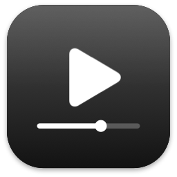
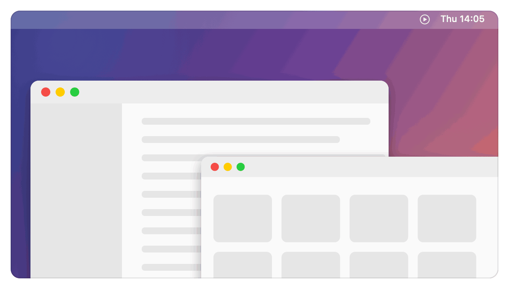

<h1 align="center">
  <picture>
    <source media="(prefers-color-scheme: dark)" srcset="docs/images/icon-dark.png">
    
  </picture>
  <br>
  NowBar
</h1>

<p align="center">A Now Playing controller for Macs that keeps working inside Mission Control.</p>

<p align="center">
  <a href="https://github.com/maxim-golubev/nowbar/releases/latest"><b>Download for Apple Silicon</b></a>
</p>

<p align="center">
  <picture>
    <source media="(prefers-color-scheme: dark)" srcset="docs/images/hero-dark.gif">
    
  </picture>
</p>

Click the play icon in the menu bar and a small controller appears in the top-right
corner of the screen you're on: the cover, the title and artist, previous, play/pause and
next, and a seek bar, for whatever the Mac is playing: Spotify, Music, a browser tab, a
podcast app. Open Mission Control and it comes along. It fades in with your swipe, its
buttons work while the window thumbnails are on screen, and it fades out as Mission
Control closes.

- **Any player:** NowBar reads the system's Now Playing information, so it follows
  whichever app macOS considers playing. A pause from AirPods, the keyboard or the app
  itself shows up on the controller: a change made by another process reached NowBar in
  138 ms (median of 12, on an M3 Pro).
- **Inside Mission Control:** clicks on the controller are handled and swallowed, so
  Mission Control never selects the window behind it, and hovering over it doesn't
  highlight the thumbnail underneath.
- **Moves with your fingers:** during a trackpad swipe the controller's opacity follows
  the swipe, and it is never left on screen after Mission Control has gone.
- **Light:** under 0.5% of one core while idle, and about 30 MB of memory. Its keyboard
  and mouse taps run only while Mission Control is open.
- **Built with:** Swift and AppKit, about 1,200 lines, no Xcode project. Core Graphics
  event taps, the Accessibility API, and
  [media-control](https://github.com/ungive/media-control) for Now Playing.

## Engineering

Mission Control isn't meant to have anything on top of it. Most of the work went into
five problems:

- **Clicks inside Mission Control go to the Dock.** A panel at window level 25 is drawn
  above Mission Control's overlays (levels 20 and 18), but the Dock takes the clicks: in a
  probe, a synthetic click on such a panel during Mission Control reached a HID event tap
  and never reached the panel. NowBar enables a HID-level tap only while Mission Control
  is open, hit-tests clicks against its own layout, acts on them and swallows them. Hover
  events over the controller are moved to the screen's edge at a session-level tap, which
  runs after the pointer has been drawn: the pointer moves normally, and the Dock never
  sees it over the thumbnail behind the controller.
- **Nothing says when Mission Control is open.** NowBar polls the window list every
  0.2 s for the Dock's full-screen overlay windows, and needs two of them, because an
  auto-hidden Dock sliding in, or Launchpad, makes one. The Dock does post an
  Accessibility notification when Mission Control opens, but it arrived about 270 ms
  after the window list had changed, so it isn't how NowBar notices the opening.
- **The controller must leave with Mission Control.** During a slow swipe the Dock draws
  its transition above everything, and when Mission Control finished closing, the
  controller was left alone on the desktop at full opacity until the next poll: for
  190 ms in a recorded close. Trackpad swipes reach a listen-only tap as Dock control
  events that carry the gesture's phase and progress, so the controller's opacity follows
  the progress, and on release it finishes the fade in 0.22 s in the direction the
  release velocity predicts. The Dock's `AXExposeExit` notification, which arrives a few
  milliseconds before its windows are removed, takes off anything still showing, and
  `AXExposeShowAllWindows` brings the controller back if the prediction was wrong.
- **Now Playing is locked down.** Since macOS 15.4, the private MediaRemote framework
  refuses apps without Apple's entitlement. media-control gets around this by loading
  its adapter into the system's own Perl, which macOS still lets in, and streams changes
  as JSON. Four details of that stream mattered. A cover arrives about 30 ms after its
  track, as a message of its own, so the previous cover stays up for up to a second
  instead of a placeholder flashing. A message that only says playback resumed carries
  the position from when it paused, so the position is re-anchored at the change;
  otherwise, resuming after an hour sent the bar to the end. Spotify gives a track a new
  identifier on every play, pause and seek, so tracks are told apart by app, title,
  artist and album. And every new stream starts with an empty state, so an empty state
  waits 250 ms before the controller says nothing is playing.
- **A tap that is off has to stay off.** Turning an event tap off sends a "tap disabled"
  event to the tap's own callback, and the usual handler for it, turning the tap back on,
  re-arms it at once: a probe counted 68 mouse events at a tap that was supposed to be
  off. An earlier NowBar had that handler, so every keystroke and mouse movement on the
  Mac went through it. Now the callback re-enables a tap only while Mission Control is
  open, and `--verbose` warns if a tap's state ever disagrees with Mission Control's.

62 tests run without the app, a screen or media-control. They feed the stream parser
bytes split inside a character, several messages at once, and the tail of a stream that
died, and check the position maths, the controller's click regions, the swipe rule and
which keys count as closing Mission Control.
`--selftest` checks the real thing: it opens Mission Control, clicks the controller's
play button through the event tap, confirms that playback changed, and puts it back.

## Limits

- It needs media-control from Homebrew, and the Accessibility permission, for the event
  taps and the Dock's notifications.
- Following the swipe relies on undocumented event fields and on private Dock
  notifications, measured on macOS 15.8. On another version the swipe may not drive the
  fade; the controller still appears and disappears with Mission Control.
- Whether a released swipe opens or closes Mission Control is predicted. When macOS
  decides otherwise, the controller corrects itself within about a third of a second.
- The controller fades out with Mission Control on Escape, Return, the Mission Control
  key, Ctrl-↑ and Ctrl-↓, and on a click outside it that isn't a drag. A close it doesn't
  see coming, through another shortcut or a hot corner, still takes it off screen, at
  the end of Mission Control's animation instead of with it. If a click didn't close
  Mission Control after all, the controller comes back after 1.5 s.
- There is one controller, on the display that has the pointer when it appears.

## Install

Requires an Apple Silicon Mac on macOS 13 or later (tested on macOS 15.8), and
[Homebrew](https://brew.sh).

1. Install media-control: `brew install media-control`
2. Download `NowBar-<version>.zip` from
   [Releases](https://github.com/maxim-golubev/nowbar/releases/latest), unzip it, and
   move `NowBar.app` to Applications.
3. Open it. The app is signed with the project's own certificate but not notarized by
   Apple, so macOS blocks the first launch: open **System Settings → Privacy & Security**
   and choose **Open Anyway**.
4. Allow Accessibility when macOS asks (**System Settings → Privacy & Security →
   Accessibility**), then open NowBar again. Click the play icon in the menu bar to show
   the controller; right-click it for Launch at Login and Quit.

When macOS has no cover for a Spotify track, NowBar asks Spotify for one, so macOS may ask
once whether NowBar may control Spotify.

## Build from source

Requires the Xcode command line tools. There is no Xcode project: `build.sh` compiles
`Sources/` with `swiftc` and assembles the app.

```sh
./test.sh                  # the tests, a few seconds
./build.sh                 # build, install to /Applications/NowBar.app, relaunch
./build.sh --no-install    # build only, into build/NowBar.app
./build.sh --release       # build/release/NowBar-<version>.zip and its SHA-256
```

`build.sh` signs with a code-signing certificate named `NowBar Dev` when the keychain has
one, so the Accessibility permission survives rebuilds; without it the app is signed ad
hoc, and Accessibility has to be allowed again after each build. To make one, open Keychain
Access, choose **Certificate Assistant → Create a Certificate**, name it `NowBar Dev` and
pick **Code Signing**.

Quit NowBar first, then run the installed copy with `--verbose` to log its state, taps
and swipes, or with `--selftest` for the Mission Control check above (it pauses or plays
for a moment and puts playback back). `Tools/make_icon.swift` draws the icon and
`docs/images/main.swift` draws the animation above; `probes/` holds the experiments
behind the engineering notes.

## Credits

Now Playing comes from [media-control](https://github.com/ungive/media-control) by
Jonas van den Berg (BSD 3-Clause), which NowBar runs as a separate program and does not
include.

MIT licensed.
